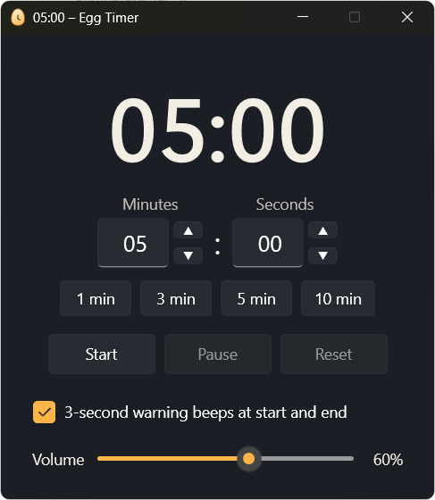

# Egg Timer

A simple countdown timer for Windows 11, built with WPF on .NET 10.



**[Download the latest EggTimer.exe](https://github.com/cvmccoy1/EggTimer/releases/latest)**. It's a single file that runs without .NET installed.

## Features
- You set the time with Minutes (0–99) and Seconds (0–59) spin boxes, or with the 1, 3, 5 and 10 minute preset buttons.
- **Start** runs a 5-second "get ready" lead-in, then the countdown. **Pause/Resume** works during both. **Reset** stops the timer and goes back to the set time.
- The optional **3-second warning beeps** sound at 3-2-1 of the lead-in and at 3-2-1 before the end.
- At 0:00 a chime plays once. The window comes to the front and its taskbar button flashes.
- The remaining time shows in the window title, and the taskbar button shows a progress bar.
- The volume control covers both the beeps and the chime.
- The last time, volume, beep setting and window position are saved in `%AppData%\EggTimer\settings.json`.

## Command line
```
EggTimer.exe 5:30
```
This preloads 5 minutes 30 seconds and saves it as the last time. It does not auto-start. The format is `M:SS` or `MM:SS`. If the argument is invalid, a warning appears and the app uses the saved time.

## Build, test, publish
```
dotnet test
dotnet publish src/EggTimer -c Release -r win-x64 --self-contained -p:PublishSingleFile=true -p:IncludeNativeLibrariesForSelfExtract=true -p:EnableCompressionInSingleFile=true -p:DebugType=none -o publish
```
The publish command creates `publish\EggTimer.exe`, a single file that runs without .NET installed.
